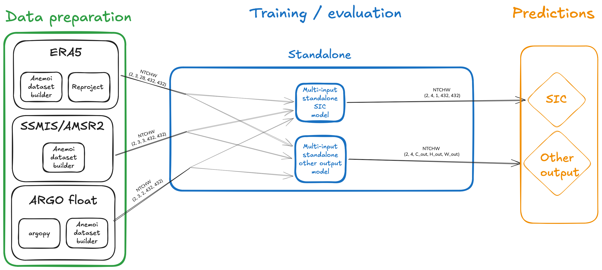
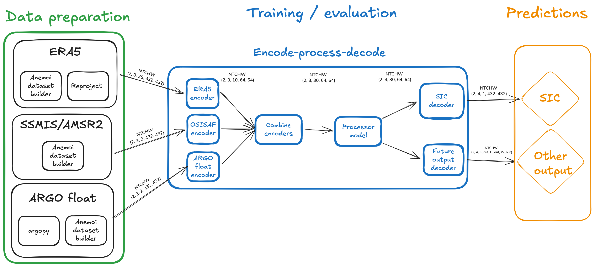

# Add a model

## Tensor format

All CryoCast models operate on tensors in `NTCHW` format:

| Dimension | Meaning |
|-----------|---------|
| `N` | Batch size |
| `T` | History steps (inputs) or forecast steps (outputs) |
| `C` | Channels / variables |
| `H` | Height |
| `W` | Width |

`N` and `T` are the same across all inputs, but `C`, `H`, and `W` may differ per dataset.

For example, with 3 history steps, and 4 forecast steps, each of the `k` inputs each have shape `(N, 3, C_k, H_k, W_k)` and the output has shape `(N, 4, C_out, H_out, W_out)`.

## Standalone models

A standalone model accepts a `dict[str, TensorNTCHW]` mapping dataset names to tensors and produces output of shape `(N, T, C_out, H_out, W_out)`.
Each model instance is typically trained to predict a single output, although this is not a hard constraint.



| | |
|---|---|
| **Pros** | All input variables available without transformation. |
| **Cons** | Combining datasets of different shapes or types must be done inside the model. |

## Processor models

A processor model sits inside an encode-process-decode pipeline.
You define a latent space `(H_latent, W_latent)` and the framework automatically creates one encoder per input and one decoder per output.

1. Each dataset-specific **encoder** maps input `(N, T_history, C_k, H_k, W_k)` to `(N, T_history, C_k_latent, H_latent, W_latent)`.
2. The `k` encoded tensors are concatenated to `(N, T_history, C_latent, H_latent, W_latent)`.
3. The **processor** maps `(N, T_history, C_latent, H_latent, W_latent)` to `(N, T_forecast, C_latent, H_latent, W_latent)`.
4. Each output-specific **decoder** maps the processor output, `(N, T_forecast, C_latent, H_latent, W_latent)`, to `(N, T_forecast, C_out, H_out, W_out)`.



| | |
|---|---|
| **Pros** | Inputs are converted into a common latent space, freeing up the model to learn time evolution. |
| **Cons** | Latent space representation may lose some spatial correlations present in the inputs. |

### ConvLSTM processor

`ConvLSTMProcessor` keeps the time dimension explicit instead of flattening the history window into channels. It consumes encoded history frames sequentially, maintains spatial hidden and cell states, and then generates forecast frames autoregressively by feeding each prediction back into the recurrent state.

A residual forecast head is enabled by default so the processor learns a latent-space tendency around persistence. Set `residual: false` to predict the next latent frame directly.

```yaml
processor:
  _target_: cryocast.models.processors.ConvLSTMProcessor
  hidden_channels: 128
  kernel_size: 3
  n_layers: 2
  dropout: 0.1
  residual: true
```

A complete example is available as `model=cnn_convlstm_cnn`.

## One-shot space-time forecasts with missing Argo

The optional `cnn_spacetime_vit_cnn` model uses `SpaceTimeVitProcessor` to
encode observed history once and decode every requested forecast lead jointly.
Causal attention between forecast queries prevents later configured queries from
altering an earlier forecast prefix in evaluation mode. Dropout remains stochastic
in training mode. Parameter shapes do not depend on the history or forecast length;
checkpoint reuse still requires compatible latent geometry, channel order and
target-slice configuration.

The processor adds residuals only to the declared target latent slice. Other
channels retain their latest observed values, so Argo remains conditioning rather
than a prognostic variable. Future targets are not read by its prediction path.
The optional `target_latent_space` constructor argument identifies this slice
separately from a surrounding model's full combined-latent training target.
Together with `target_channel_offset`, it preserves prediction-only Argo semantics
when used with full-latent diffusion support. Legacy direct callers can still use
`data_space_target` and `target_channel_offset`. This metadata changes neither
parameter shapes nor existing checkpoint weights. A missing or invalid slice is
rejected; it never defaults to forecasting all conditioning channels.

`MissingDataCNNEncoder` replaces nonfinite measurements with zero and supplies an
availability channel. Its finite `missing_fill_value` describes a **complete missing
time slice**, matching the missing-date loader's all-`-1` tensor convention. A finite
measurement equal to `-1` inside an otherwise observed frame remains available.
Per-pixel missing values should use NaN or another explicit nonfinite marker.
If an entire real frame can equal the configured sentinel, that representation is
ambiguous; use nonfinite missing-date values and `missing_fill_value=None` instead.

Conditioning dropout removes whole history slices only during training. The input
adapter starts as an identity without consuming random draws, so adding the neutral
adapter does not alter subsequent seeded model initialization. Existing adapter
state dictionaries still load strictly. Preserving individual sentinel-valued
measurements is an intentional correction; complete missing frames behave as before.

Regression tests cover causal prefix values and history gradients, target isolation,
non-target persistence, invalid dimensions, missing-value gradients, and safe
processor checkpoint restoration with an identical next Adam update. These checks
validate the implementation; improved forecast accuracy over persistence or other
processors still requires a matched forecast-level evaluation.
