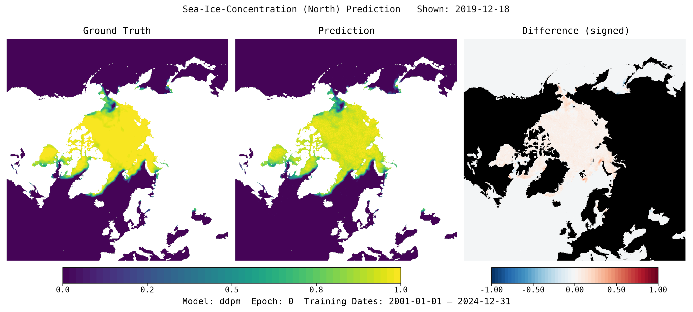

# CryoCast

**CryoCast** is a multimodal machine-learning framework for short-term Arctic and Antarctic sea-ice concentration forecasting. Available input datasets include satellite-derived OSI SAF sea-ice concentration, ERA5 atmospheric reanalysis and Argo ocean observations. The selected [data and model configuration](user-guide/configuration.md) determines which inputs a run uses.

In the modular encode-process-decode models, dataset-specific encoders map inputs onto a common latent grid, a processor forecasts from the combined representation, and a decoder maps the result to the target grid. The framework also provides standalone models and baselines. See [model development](how-to/add-a-model.md) for the supported interfaces and tensor conventions.

## Forecast examples

The figures below compare Arctic and Antarctic sea-ice concentration forecasts with observations. These illustrative outputs do not establish general forecasting skill across models, seasons or regions.

### Arctic



### Antarctic


## Capabilities

- [Multimodal data ingestion](user-guide/data.md) for satellite-derived sea ice, atmospheric reanalysis and ocean float observations
- [Configurable model components](user-guide/configuration.md), including UNet, vision-transformer and diffusion models, plus a persistence baseline
- [Single-stage](how-to/train.md) and [multistage training](how-to/train-multistage.md), checkpoint-based [evaluation](how-to/evaluate.md) and [hyperparameter sweeps](how-to/sweeps.md)
- [Per-forecast-day metrics](user-guide/metrics.md) and [notebooks](user-guide/notebooks.md) for inspecting model behaviour and research examples

## Getting started

CryoCast requires Python 3.11 or later. Follow the [installation guide](user-guide/installation.md) to install `uv` and check platform-specific prerequisites, then use the repository's managed environment:

```bash
git clone https://github.com/alan-turing-institute/cryocast.git
cd cryocast
uv sync --managed-python
uv run cryocast --help
```

Set a local `base_path` and choose datasets and a model using the [configuration guide](user-guide/configuration.md). ERA5 downloads require CDS access; standard training configurations use Weights & Biases. The [commands guide](user-guide/commands.md) describes those prerequisites, offline logging and the separate `synthetic` configuration for locally generated data and local-file reporting. Installation alone does not download forecasting datasets or supply a trained checkpoint.

## Documentation

- [User Guide](user-guide/index.md) for installation, configuration, data preparation, commands, metrics and notebooks
- [How-to guides](how-to/index.md) for model development, training, evaluation, sweeps and release workflows
- [API Reference](api/index.md) for module and class documentation
- [Model card](https://github.com/alan-turing-institute/cryocast/blob/main/docs/MODEL_CARD.md) for intended use, limitations and the documented research maturity

## Research scope

CryoCast is developed at The Alan Turing Institute for research and exploratory inference. The presence of a model configuration or example forecast does not establish validated operational performance. Operational forecasting, safety-critical decision making and public warnings are outside the stated intended use. Consult the [model card](https://github.com/alan-turing-institute/cryocast/blob/main/docs/MODEL_CARD.md) before interpreting or using its outputs.
