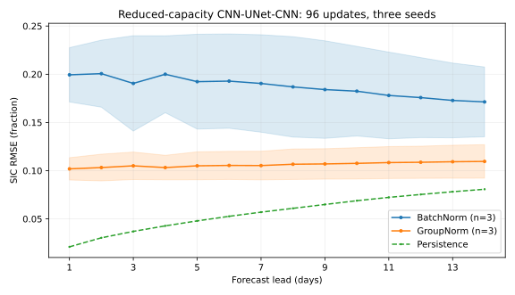
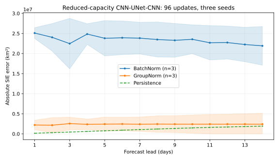

# Additional BatchNorm versus GroupNorm evidence (issue #575)

This is a **separate, reduced-capacity** follow-up to the original 44.7-million-parameter,
two-seed, 20-step trial in [the configuration guide](../user-guide/configuration.md).
It does not replace the original production-configuration results.

## Matched protocol

- Model: CryoCast CNN–UNet–CNN, with `UNetProcessor.start_out_channels=16`
  instead of the production setting of 128. Both normalization arms have
  **1,256,655 total parameters** (1,256,337 trainable and 318 in the frozen, unused target encoder), so this is a lower-capacity ablation.
- Change under test: the **processor's** `norm_type` is either `batchnorm` or
  `groupnorm`. The decoder's normalization is unchanged.
- Inputs: 25 km OSI SAF southern-hemisphere sea ice concentration (SIC) and
  ERA5 reanalysis, using the same configuration for both arms. Argo is excluded.
- Dates: the project's `sample_south` split assigns 2020–2021 to training,
  selected months in 2022–2023 to validation (not used for early stopping here),
  and January/July 2024 to held-out testing.
- Seeds: 575, 576, 577, each paired BatchNorm and GroupNorm.
  Budget: **96 optimizer updates per arm**, batch size 1, one bounded epoch,
  no early stopping or validation-driven selection.
- Forecast: a 14-day **autoregressive** rollout over the first **10**
  held-out test windows, with identical windows for every run.
  These first ten windows are in **January 2024**; the July holdout is
  part of the dataset split but was not evaluated in this extension.
- Metrics: ocean-mask SIC RMSE per lead; absolute *per-example*
  sea-ice-extent (SIE) error per lead at the 15% SIC threshold, using
  the 625 km² EASE-grid cell area; and persistence on the same windows.
  SIE errors are made absolute **before** averaging test examples.
- Hardware: Apple M5 Pro MPS with 24 GB unified memory and single-process
  data loader. The original full-size model was too expensive to repeat
  across three seeds on this machine; the reduced-size setup was chosen
  to make the matched 96-step trial feasible.
- Data compatibility: the legacy OSI SAF/ERA5 Anemoi Zarr stores require
  `ANEMOI_DATASETS_MISSING_DATES_FIX_EXPERIMENTAL=1`. This is an **in-memory**
  missing-date indexing compatibility mode; no original data were rewritten.
  I independently verified that both OSI SAF and ERA5 have 855 stored rows
  aligned to the same calendar (1674 days minus 819 declared missing days).
  The [read-only dataset and mask SHA-256 manifest](../assets/norm-evaluation-575-extended-data-manifest.json)
  records the date-index and metadata checksums for auditability.

## Results

The following values are means over **three paired seeds** (± one sample
standard deviation across seeds); persistence has the same values across
runs and therefore shows no seed SD. SIE figures are in **million km²**,
and use the **mean absolute per-window error**, not the absolute of a
signed mean.

| Method | Mean 14-day SIC RMSE | Days 10–14 RMSE | Mean abs. SIE error (million km²) | Days 10–14 abs. SIE error (million km²) |
| --- | ---: | ---: | ---: | ---: |
| BatchNorm | 0.1870 ± 0.0427 | 0.1761 ± 0.0414 | 23.43 ± 3.72 | 22.63 ± 4.13 |
| GroupNorm | 0.1062 ± 0.0149 | 0.1087 ± 0.0168 | 2.40 ± 1.96 | 2.42 ± 2.49 |
| Persistence | 0.0564 | 0.0751 | 1.10 | 1.72 |

GroupNorm's cross-seed mean RMSE was **43.2% lower**
than BatchNorm at 96 updates. GroupNorm was better in
**3/3** paired seeds, and BatchNorm in **0/3**.
The individual paired RMSE differences (GroupNorm minus BatchNorm)
were -0.1149, -0.0595, -0.0680; three seeds do not
support reliable confidence intervals or a significance test.
Neither trained arm outperformed persistence on the 10 held-out January windows.

The mean wall-clock duration per 96-update training run was
**306 ± 39 seconds**
for BatchNorm and
**316 ± 111 seconds**
for GroupNorm (mean ± SD over three seeds). These are illustrative
single-machine timings, **not** controlled throughput benchmarks.





The shaded bands are ± one **sample standard deviation over three seeds**,
not confidence intervals. See the complete
[seed-level CSV](../assets/norm-evaluation-575-extended-seeds.csv) and
[per-lead mean/SD CSV](../assets/norm-evaluation-575-extended-daily.csv).
The six [raw seed-by-normalisation JSON results](https://github.com/sylvesterkaczmarek/icenet-mp/tree/research/groupnorm-unet-575/validation/norm-evaluation-575-extended/raw)
and their [SHA-256 manifest](https://github.com/sylvesterkaczmarek/icenet-mp/blob/research/groupnorm-unet-575/validation/norm-evaluation-575-extended/raw/manifest.json)
are committed so that results can be independently recomputed.
Checkpoint weights, execution logs and a separate complete copy of raw
results remain on the T7 research-data volume.
The benchmark was executed from the frozen source revision
`cf513de2f90c53e2faf0cc86d36f66365a88270b` using a runner with
SHA-256 `b0b0141f344c18e5bf28f6580fe9dffbf1bd08f0bb372d39d35bcb9dd93213ab`.
That exact runner can be recovered from the recorded commit; subsequent
packaging/type-checking changes to the same experiment script do not
retroactively alter the measured results.

**Interpretation:** the original 20-update **full-size** pilot favoured
BatchNorm, while this 96-update **smaller-model** comparison gave a
lower GroupNorm mean RMSE. They are different protocols and
must **not** be pooled into a production claim. Keep the shipped
BatchNorm default pending a comparable full-size, convergence-checked
study across more seeds and held-out dates.


## Interpretation and limitations

The original full-size experiment trained for just 20 updates. This
follow-up increases update count and measures seed-level variation but
**reduces model capacity**. Its absolute metrics cannot be pooled with
the earlier 44.7M-parameter trial or used to claim its outcome.

Ninety-six updates and a small selected sample of held-out windows do
**not** establish converged training, seasonal reliability, production
skill, statistical significance, or architecture-wide superiority.
Argo data and alternative encoder/decoder families were not tested.
A full-capacity, converged multi-seed experiment on broader datasets
remains necessary before reconsidering the shipped BatchNorm default.

## Reproduction

The runnable protocol is
[`validation/norm-evaluation-575-extended/run.py`](../../../validation/norm-evaluation-575-extended/run.py).
The runner records its exact source revision, script SHA-256, environment
versions, seed, model parameters, optimizer updates, and per-lead metrics,
one JSON file per run. Raw JSON and the 9+ GB dataset stores remain on
external research storage; aggregated machine-readable CSV is committed
with this report.

```bash
export CRYOCAST_NORM_DATA_ROOT=/path/to/prepared/cryo-data-root
export CRYOCAST_NORM_OUTPUT_DIR=/path/to/external-research-output
export ANEMOI_DATASETS_MISSING_DATES_FIX_EXPERIMENTAL=1
export PYTORCH_ENABLE_MPS_FALLBACK=1
PYTHONPATH=. python validation/norm-evaluation-575-extended/run.py
```

The compatibility flag is needed for the documented legacy stores;
new datasets should instead be prepared in current Anemoi format.
