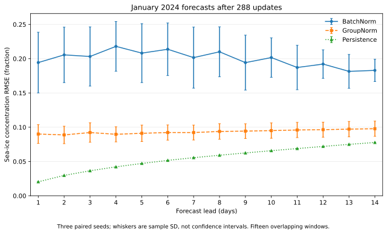
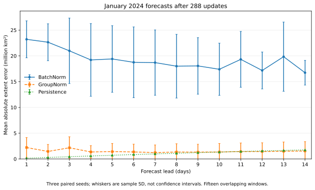
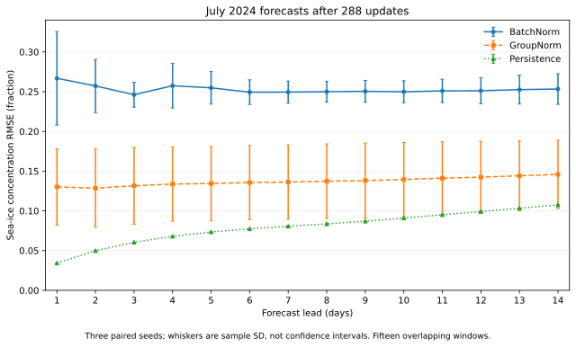
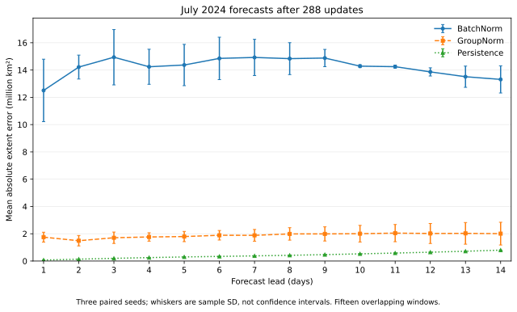
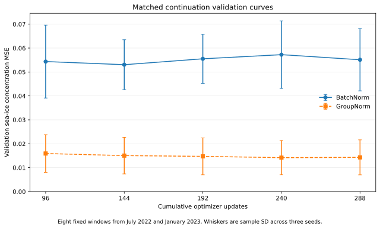

# Longer matched normalization training

This follow-up to [PR #594](https://github.com/alan-turing-institute/cryocast/pull/594) continues the six recorded [96-update runs](norm-evaluation-575-extended.md). It adds training without changing their spatial resolution or capacity, and expands testing from ten January windows to all fifteen January and fifteen July 2024 windows.

## What was held constant

Both arms retain the CNN-UNet-CNN with 1,256,655 total parameters (1,256,337 trainable and 318 in the frozen, unused target encoder) with processor width 16, 432 x 432 physical grids, 144 x 144 latent grids, three observed history days and a full fourteen-day latent autoregressive forecast. ERA5 and OSI SAF inputs, Huber loss with delta 0.5, batch size one, decoder normalization and all model defaults are unchanged. Argo is excluded from both arms. These remain reduced-capacity models relative to the 44.7-million-parameter production configuration.

Three paired seeds, 575/576/577, restore their own exact 96-update model checkpoints and AdamW moments. Each receives **192 additional updates**, giving **288 total updates per run** and **1,152 newly executed optimizer updates**. Both arms of a seed receive byte-identical training arrays in the same order; all 192 newly selected windows are distinct. The earlier 96-update histories are inherited, not rerun or asserted to have identical training arrays retrospectively.

## Learning-rate and selection protocol

The prior one-epoch scheduler had already reduced the learning rate to 0.000001. Continuing at that terminal rate would answer a different question. This study preregisters an identical cosine restart from **0.001 to 0.00001** across the 192 additional updates, retaining AdamW moments, weight decay 0.01 and gradient clipping at norm one. This is a controlled continuation with an explicit restart, **not an uninterrupted replay of the old schedule** and not a new from-scratch 288-update experiment.

The primary comparison is the fixed final 288-update checkpoint. A secondary comparison uses the lowest common-mask validation MSE at 96, 144, 192, 240 or 288 updates, allowing the original checkpoint to remain selected. Eight fixed validation windows are balanced across July 2022 and January 2023. All six measured-run selections are frozen before their test forecasts are scored. A separate two-update plumbing smoke check reused the already-explored first January window before the measured run; its scores are excluded and did not change the fixed protocol. No model, seed, checkpoint or learning rate is selected using the new test results.

Training uses 2020-2021 windows. A calendar-level check includes every history and forecast date and finds no overlap with validation or test years. Existing source normalization statistics end in November 2021. A separate status-flag audit reconstructs masks from all 855 stored days and from the 731 training days alone: both reproduce the stored ocean and active masks exactly, with zero differing cells. This is a verified property of this fixed snapshot, not a general guarantee for every dataset. The legacy stores use the explicitly enabled in-memory Anemoi missing-date correction; source metadata, date indices, masks and original checkpoint hashes remain unchanged.

## Final 288-update results

RMSE is pooled over valid pixels and windows separately for each lead, then averaged over the fourteen leads. The late-horizon measure averages leads 10-14. SIE uses a strict 15% threshold and nominal 625 km² grid cells; its error is made absolute **per window before averaging**. January and July are reported separately and together. The thirty overlapping windows cover 56 distinct forecast-target dates; repeated appearances of a date are not independent observations. Values are mean ± sample standard deviation across three seeds; persistence has no seed variation.

| Test month | Method | Mean 14-day RMSE | Days 10-14 RMSE | Mean MAE | Mean absolute SIE (million km²) |
| --- | --- | ---: | ---: | ---: | ---: |
| 2024-01 | BatchNorm | 0.1996 ± 0.0339 | 0.1891 ± 0.0234 | 0.0990 ± 0.0242 | 19.2454 ± 4.4310 |
| 2024-01 | GroupNorm | 0.0934 ± 0.0113 | 0.0965 ± 0.0111 | 0.0255 ± 0.0062 | 1.5129 ± 1.6263 |
| 2024-01 | Persistence | 0.0546 | 0.0719 | 0.0090 | 1.0076 |
| 2024-07 | BatchNorm | 0.2528 ± 0.0206 | 0.2516 ± 0.0165 | 0.1330 ± 0.0100 | 14.2124 ± 0.4119 |
| 2024-07 | GroupNorm | 0.1371 ± 0.0465 | 0.1426 ± 0.0449 | 0.0554 ± 0.0231 | 1.8828 ± 0.4524 |
| 2024-07 | Persistence | 0.0793 | 0.0992 | 0.0169 | 0.4168 |
| combined | BatchNorm | 0.2281 ± 0.0260 | 0.2228 ± 0.0181 | 0.1160 ± 0.0167 | 16.7289 ± 2.4214 |
| combined | GroupNorm | 0.1179 ± 0.0305 | 0.1224 ± 0.0287 | 0.0404 ± 0.0135 | 1.6978 ± 0.9930 |
| combined | Persistence | 0.0681 | 0.0866 | 0.0130 | 0.7122 |

For **2024-01**, GroupNorm has lower mean RMSE in **3/3** paired seeds; GroupNorm minus BatchNorm differences are -0.13341, -0.09512, -0.09015. The numbers of seeds beating persistence are **0/3** for BatchNorm and **0/3** for GroupNorm. For **2024-07**, GroupNorm has lower mean RMSE in **3/3** paired seeds; GroupNorm minus BatchNorm differences are -0.10459, -0.14897, -0.09379. The numbers of seeds beating persistence are **0/3** for BatchNorm and **0/3** for GroupNorm. For **combined**, GroupNorm has lower mean RMSE in **3/3** paired seeds; GroupNorm minus BatchNorm differences are -0.11619, -0.12389, -0.09065. The numbers of seeds beating persistence are **0/3** for BatchNorm and **0/3** for GroupNorm.

## Effect of the additional training

The initial 96-update checkpoints are replayed on the **same thirty windows** as their final states. This isolates the added-training comparison from the expansion of the January-only test set. Negative paired change means lower RMSE after continuation; the spread is sample SD of the three seed-wise changes.

| Test month | Method | 96-update mean RMSE | 288-update mean RMSE | Paired change ± seed SD | Seeds improving |
| --- | --- | ---: | ---: | ---: | ---: |
| 2024-01 | BatchNorm | 0.1869 | 0.1996 | +0.0127 ± 0.0152 | 0/3 |
| 2024-01 | GroupNorm | 0.1037 | 0.0934 | -0.0103 ± 0.0057 | 3/3 |
| 2024-07 | BatchNorm | 0.2595 | 0.2528 | -0.0066 ± 0.0100 | 2/3 |
| 2024-07 | GroupNorm | 0.1397 | 0.1371 | -0.0026 ± 0.0030 | 2/3 |
| combined | BatchNorm | 0.2270 | 0.2281 | +0.0012 ± 0.0077 | 1/3 |
| combined | GroupNorm | 0.1236 | 0.1179 | -0.0057 ± 0.0034 | 3/3 |

## Validation-selected secondary comparison

| Test month | Method | Mean 14-day RMSE | Days 10-14 RMSE | Mean MAE | Mean absolute SIE (million km²) |
| --- | --- | ---: | ---: | ---: | ---: |
| 2024-01 | BatchNorm | 0.1878 ± 0.0432 | 0.1715 ± 0.0386 | 0.0941 ± 0.0266 | 20.5365 ± 2.8595 |
| 2024-01 | GroupNorm | 0.0891 ± 0.0063 | 0.0919 ± 0.0054 | 0.0235 ± 0.0039 | 1.0916 ± 0.7941 |
| 2024-01 | Persistence | 0.0546 | 0.0719 | 0.0090 | 1.0076 |
| 2024-07 | BatchNorm | 0.2521 ± 0.0112 | 0.2550 ± 0.0016 | 0.1321 ± 0.0103 | 14.3156 ± 0.4231 |
| 2024-07 | GroupNorm | 0.1382 ± 0.0477 | 0.1437 ± 0.0461 | 0.0562 ± 0.0240 | 2.0081 ± 0.6824 |
| 2024-07 | Persistence | 0.0793 | 0.0992 | 0.0169 | 0.4168 |
| combined | BatchNorm | 0.2232 ± 0.0246 | 0.2183 ± 0.0141 | 0.1131 ± 0.0182 | 17.4260 ± 1.6302 |
| combined | GroupNorm | 0.1170 ± 0.0298 | 0.1214 ± 0.0278 | 0.0399 ± 0.0130 | 1.5499 ± 0.7350 |
| combined | Persistence | 0.0681 | 0.0866 | 0.0130 | 0.7122 |

| Seed | Method | Validation-selected total updates | Initial validation MSE | Final validation MSE |
| ---: | --- | ---: | ---: | ---: |
| 575 | BatchNorm | 144 | 0.070313 | 0.069999 |
| 575 | GroupNorm | 240 | 0.021370 | 0.019878 |
| 576 | BatchNorm | 96 | 0.039952 | 0.045989 |
| 576 | GroupNorm | 288 | 0.006885 | 0.006018 |
| 577 | BatchNorm | 288 | 0.052802 | 0.049354 |
| 577 | GroupNorm | 240 | 0.019482 | 0.017023 |

Including the starting checkpoint prevents a worse continuation from being presented as an improvement through forced final-step selection. Conversely, the primary fixed-budget table remains visible and is not replaced by a selectively favorable checkpoint table.

## Per-lead and validation figures

Whiskers show sample standard deviation across three training seeds, **not confidence intervals**. Fifteen windows within each month share many observed and forecast dates; they are not fifteen independent seasonal replications.

## Independent verification

A separate verifier, which does not import the training runner's metric implementation, hashes and re-scores all **7,980 per-origin/per-lead records** from saved forecast arrays using NumPy. It verifies prediction-independent masks, finite predictions, pixel counts, squared and absolute errors, paired absolute extent errors, training-order/data hashes, safe checkpoint checksums and validation-only selection. It also checks the initial checkpoints against the original ten-window January results within an explicitly declared float32-versus-float64 reduction tolerance.

The frozen experiment source is `ce99c371669d15278a1f451ad5bcbf4e752f100e` and runner SHA-256 is `7713c8a50ee680083822c00ff1bf1fd2171a9bacee1f7ca6ba290e9351556e29`. Reproduction code and compact numerical evidence are in [`validation/norm_594_longer`](https://github.com/sylvesterkaczmarek/icenet-mp/blob/research/groupnorm-unet-575/validation/norm_594_longer/README.md). Full forecast arrays, model weights and execution logs remain on the external research volume; none are committed as repository data.

## Decision and remaining limits

Keep the shipped BatchNorm default. This experiment adds a longer full-grid continuation and a July holdout to the existing evidence. It does not establish converged full-capacity training, general superiority across encoder/decoder families, Argo-conditioned performance or release-level seasonal reliability. January data have already been explored in the earlier study, and July covers only one month in one year. The protocol was fixed before continuation, but the study is a follow-up to known preliminary results rather than an independent confirmatory trial.

At batch size one, 288 total updates remain less than a full pass over the 715 eligible training windows; the inherited 96-update sample history can also overlap the new continuation windows. The existing preprocessing includes its NaN-to-zero SIC ingestion policy; this comparison does not reconstruct original missingness or introduce a new QC filter. Prepared finite values and the fixed ocean mask define scoring support. The training and validation curves are reported rather than used to assert convergence. Three seeds support descriptive paired differences only; no significance or population confidence interval is claimed. MPS execution reports a nondeterministic indexed-accumulation operation in backward; seeded schedules and saved evidence are reproducible, but bitwise-identical retraining on every machine is not promised.

No production defaults or trained normalization architectures are switched. BatchNorm and GroupNorm checkpoints remain architecture-specific. A from-scratch, full-capacity, independently selected study over more years and configurations is still required before any default change.
