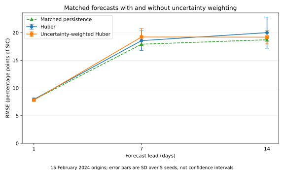
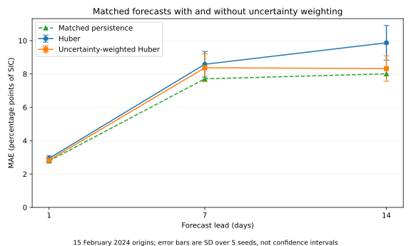
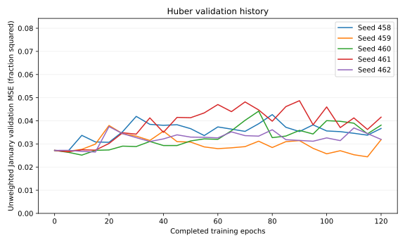
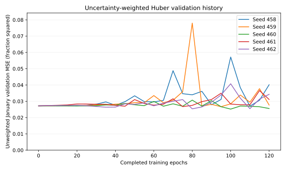

# Uncertainty-weighted Huber on matched forecasts

This retrospective regional experiment compares PR #458's actual
`UncertaintyWeightedLoss` with ordinary `torch.nn.HuberLoss`, changing
**only the training objective**. It uses real OSI SAF observation uncertainties,
not generated uncertainty labels. It supplies exploratory evidence for #303
and #243, without claiming full-release forecasting skill.

## Selected-checkpoint results

Mean ± sample SD across five paired seeds. MAE and RMSE are in percentage
points of sea ice concentration (SIC). MSE skill is computed per seed as
`1 - model_MSE / persistence_MSE`, then averaged. The RMSE mean is the mean
of per-seed RMSE values, not a square root of pooled MSE.

| Method | Lead (days) | MAE (pp) | RMSE (pp) | MSE skill vs persistence |
| --- | ---: | ---: | ---: | ---: |
| Huber | 1 | 2.940 ± 0.171 | 7.950 ± 0.240 | -1.85% |
| Huber | 7 | 8.580 ± 0.764 | 18.561 ± 1.770 | -8.14% |
| Huber | 14 | 9.867 ± 1.040 | 20.003 ± 2.812 | -16.06% |
| Uncertainty-weighted Huber | 1 | 2.835 ± 0.128 | 7.813 ± 0.206 | +1.63% |
| Uncertainty-weighted Huber | 7 | 8.370 ± 0.836 | 19.218 ± 1.536 | -15.69% |
| Uncertainty-weighted Huber | 14 | 8.323 ± 0.764 | 19.188 ± 1.219 | -5.47% |
| Persistence | 1 | 2.781 | 7.880 | 0.00% |
| Persistence | 7 | 7.706 | 17.913 | 0.00% |
| Persistence | 14 | 8.007 | 18.714 | 0.00% |

- At 1 day: weighted mean RMSE is 1.7% lower than Huber, with 4/5 paired-seed wins and 0/5 ties.
- At 7 days: weighted mean RMSE is 3.5% higher than Huber, with 1/5 paired-seed wins and 0/5 ties.
- At 14 days: weighted mean RMSE is 4.1% lower than Huber, with 2/5 paired-seed wins and 0/5 ties.

The comparison with ordinary Huber and the comparison with persistence are
separate. All absolute errors and both signs of skill are retained. The data
and run count do not support a broad claim that weighting genuinely improves
forecasting accuracy; keep it opt-in pending independent seasonal evaluation.





## Matched protocol

- Five seeds, [458, 459, 460, 461, 462], with two loss arms each. The same small real
  CryoCast `EncodeProcessDecode` UNet is used: 172,831 parameters, width 8,
  BatchNorm processor, two observed SIC history frames, daily physical-space
  autoregressive rollout and an additive persistence residual. This is a
  reduced-capacity SIC-only model, not the release model or all its inputs.
- Every pair has identical initial weights, model architecture, input tensors,
  training masks, shuffled origin order, Adam settings and compute budget.
  Each arm executes 120 epochs, **1,800 updates**, batch size 8, LR 0.0001,
  weight decay 0.0001, clip gradient norm at 1.0, on CPU with two threads.
  This protocol was frozen before scoring, with no subsequent rerun or tuning
  based on the held-out results.
- Both losses use Huber delta 0.5. Weighted loss applies inverse variance
  `1/max(sigma, 0.01)^2`, normalised by the batch's sum of weights. Nonpositive,
  nonfinite and sigma > 1 are invalid. Both arms use the **same valid-sigma
  training pixels**, so dropping missing uncertainty is not an arm difference.
- Uncertainty is a **future-target loss label only**. It is absent from the
  model input variable list. Input SIC and target SIC use physical fractions;
  sigma is read in physical fractions after CF decoding and division by 100.
- Training is January-April 2023 (118 eligible origins). January 2024 validation
  (16 origins) selects the minimum **unweighted** 1/7/14-day MSE checkpoint,
  checked every five epochs. February 2024 has 15 identical test origins,
  February 1-15, and the same one-, seven-, and fourteen-day targets for both
  arms and persistence. Two history frames end at each issue date; no future
  observations or future sigma enter a forecast.
- Test masks require the training-derived ocean mask plus valid history and
  target SIC; **test uncertainty does not filter or weight the metrics**.
  Persistence repeats the last issue-time observation over precisely those
  truth dates and pixels. All ten checkpoints were frozen before test scoring.

## Weight distribution and checkpoint selection

Training has 420,621 common valid-sigma pixels out of
422,912 otherwise-valid SIC pixels across origins.
The global inverse-weight effective sample fraction is
48.5% (diagnostic
`sum(w)^2 / (N sum(w^2))`; the actual loss is normalised within each batch).
This weighting changes which locations dominate the objective; the
uncertainty-weighted training loss must not be compared numerically with
an unweighted Huber loss as though they measured the same objective.

| Seed | Loss | Selected epoch | Updates executed | Best January MSE |
| ---: | --- | ---: | ---: | ---: |
| 458 | Huber | 5 | 1800 | 0.026937 |
| 458 | Uncertainty-weighted Huber | 110 | 1800 | 0.027036 |
| 459 | Huber | 115 | 1800 | 0.024434 |
| 459 | Uncertainty-weighted Huber | 95 | 1800 | 0.026683 |
| 460 | Huber | 10 | 1800 | 0.025172 |
| 460 | Uncertainty-weighted Huber | 100 | 1800 | 0.025216 |
| 461 | Huber | 5 | 1800 | 0.026585 |
| 461 | Uncertainty-weighted Huber | 75 | 1800 | 0.026747 |
| 462 | Huber | 15 | 1800 | 0.026505 |
| 462 | Uncertainty-weighted Huber | 80 | 1800 | 0.025373 |

The identical epoch-zero model is explicitly the persistence anchor and is
eligible for selection; 0/10 selected models stayed at that anchor.
These ties are retained. Selection uses the same unweighted criterion for
both arms. Volatile validation curves and the bounded budget do not establish
convergence. Final-budget performance is also shown below, without replacing
or selecting results using the test set.





## Fixed-budget final-checkpoint sensitivity

The following scores use epoch 120 for every arm and seed, irrespective of
validation selection. They are a disclosed secondary sensitivity analysis,
not an alternative selected after seeing which outcome was preferable.

| Method | Lead (days) | MAE (pp) | RMSE (pp) | MSE skill vs persistence |
| --- | ---: | ---: | ---: | ---: |
| Huber | 1 | 3.233 ± 0.119 | 8.351 ± 0.266 | -12.41% |
| Huber | 7 | 9.361 ± 0.485 | 20.179 ± 0.950 | -27.13% |
| Huber | 14 | 12.218 ± 2.263 | 24.717 ± 3.433 | -77.13% |
| Uncertainty-weighted Huber | 1 | 2.834 ± 0.075 | 7.726 ± 0.067 | +3.85% |
| Uncertainty-weighted Huber | 7 | 8.739 ± 0.945 | 18.832 ± 1.096 | -10.83% |
| Uncertainty-weighted Huber | 14 | 9.194 ± 1.600 | 19.114 ± 1.766 | -5.03% |
| Persistence | 1 | 2.781 | 7.880 | 0.00% |
| Persistence | 7 | 7.706 | 17.913 | 0.00% |
| Persistence | 14 | 8.007 | 18.714 | 0.00% |

## Scope and limitations

The observed fields and actual `total_standard_uncertainty` come from
[OSI SAF OSI-438](https://osi-saf.eumetsat.int/products/osi-438), AMSR-derived
25 km northern EASE2-grid NetCDFs, DOI 10.15770/EUM_SAF_OSI_0024, produced by
the Norwegian Meteorological Institute with attribution to EUMETSAT OSI SAF
under CC BY 4.0. They are **not SSMIS observations**. The loss accepts the same
physical sigma variable; this experiment does not validate a separate SSMIS
product. Original NetCDFs are retained and individually SHA-256 checked.

The 64x64 crop (rows 232:296, columns 206:270) and its 3,584-pixel training-only
ocean mask are reused from the earlier observed-data work. SIC status/validity
rules, including exclusion of status bit 128, are inherited symmetrically;
sigma adds a common training validity condition. Uncertainty represents the
provider's retrieval error estimate, not complete forecast-target uncertainty
or guaranteed independent Gaussian noise. Inverse-variance weighting of Huber
is a modelling choice, not a proof of statistical optimality.

This short winter holdout was **already explored in prior experiments**.
The 15 origins overlap, pixels are spatially correlated, and five random
initialisations are not five independent datasets. SD bars show seed variation,
not confidence intervals. No p-values, significance or operational skill claims
are made. This is an analysis-time hindcast using a reprocessed product; issue-time
data availability and latency are not simulated. The single-region, SIC-only,
small-model comparison cannot close #243 or justify changing the default loss.

## Source audit and reproduction

The independent auditor reconstructs the actual training inputs and masks,
checks raw uncertainty file hashes, rebuilds truth and persistence from original
observations, verifies frozen weights and paired initialization/order/update
counts, and recomputes all **900 per-case error sums** without importing the
training program's scoring helper. It checks both selected and final checkpoints.

Small records in [evidence](evidence/) contain the full case table, per-seed
metrics, dates, training curves, raw-file hashes and source checksums. Forecast
arrays, original NetCDFs, Anemoi data stores, checkpoint weights and execution
logs remain on external research storage, not in this PR.

The earlier [source-preparation package](https://github.com/sylvesterkaczmarek/icenet-mp/tree/139bd3f5b573fc61bef7d561fafb9beb7f75142c/validation/x0scale-478-expanded)
records the input archive and crop preparation. Reuse the checksum-identified
source bundle; do not substitute differently preprocessed observations.

```bash
PYTHONPATH=. WANDB_MODE=disabled python validation/uncertainty_458/run.py \
  --source /path/to/x0scale-478-expanded-20261011 --out /path/to/new-experiment
python validation/uncertainty_458/audit.py --source /path/to/source \
  --experiment /path/to/new-experiment --out /path/to/new-audit
python validation/uncertainty_458/report.py --audit /path/to/new-audit/audit.json \
  --out /path/to/new-report
```

The frozen runner revision is `71aa009033751d07082b88c9125f1f3031a6806b`, runner SHA-256
`722b09d61d5b20c5bb6c54f1ff1556e24bf7aceccc0f58ff8265ec22daff4d21`; the input bundle SHA-256 is
`949a176a64a7e7dece6b8953cbb740fcaf38900bd58a57efe6aa6dc1961dd9b1`. Exact environment versions are recorded in the
protocol. Cross-platform bitwise reproducibility is not promised.

## Defects corrected before the experiment

The data path checked sigma against the filtered model-input variables instead
of the underlying stored variables. This wrongly required sigma to appear among
inputs. It now reads sigma directly from disk as a separate physical-scale target
without exposing it to the model. A real SingleDataset regression covers this.

Half-precision reductions could overflow even on a 64x64 image; nonfinite
parameters were accepted, and excluded NaN targets could contaminate the Huber
loss and gradients through multiplication by zero. Relative bounded weights,
at-least-float32 arithmetic, explicit parameter validation and selection before
loss calculation fix these defects. Uniform-weight objective/gradient equivalence
and double precision are retained. Ordinary Huber defaults remain unchanged.
