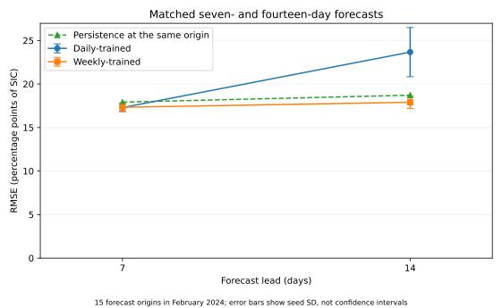
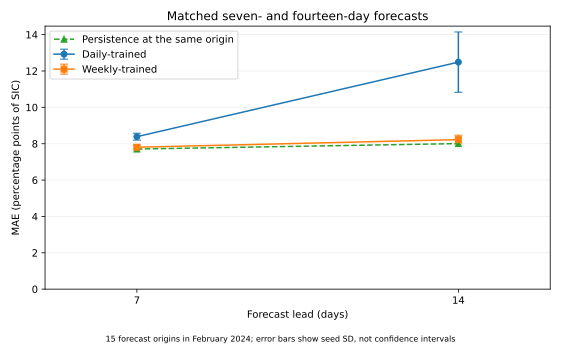
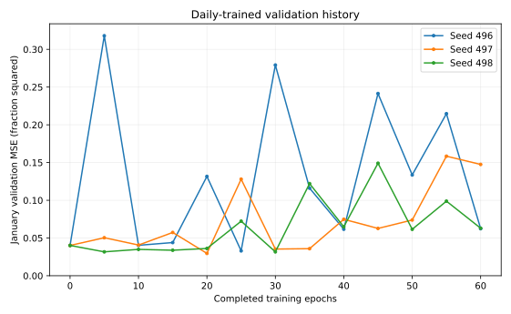
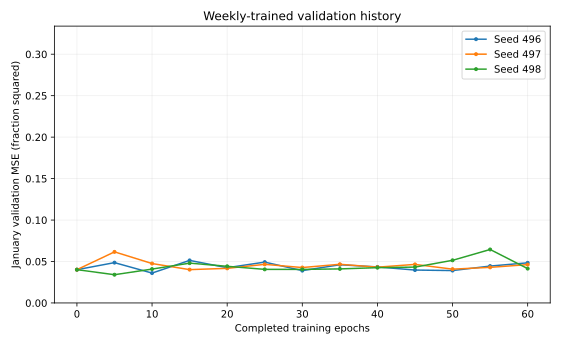

# Weekly forecasting on matched dates

This bounded, retrospective experiment exercises PR #496's real `SingleDataset`
and `CombinedDataset` paths and compares daily-trained and weekly-trained
CryoCast models with **the same persistence forecast at the same issue dates,
valid dates and ocean pixels**. It provides exploratory evidence for #243,
not a full-release benchmark or a basis for closing that issue.

## Results

Values are mean ± sample standard deviation across three paired seeds.
MAE and RMSE are percentage points of sea ice concentration (SIC).
MSE skill is `1 - model_MSE / persistence_MSE`, calculated per seed and then
averaged. RMSE means are averages of the three per-seed RMSE values.

| Method | Lead (days) | MAE (pp) | RMSE (pp) | Mean MSE skill vs persistence |
| --- | ---: | ---: | ---: | ---: |
| Daily-trained | 7 | 8.388 ± 0.188 | 17.293 ± 0.445 | +6.77% |
| Daily-trained | 14 | 12.488 ± 1.658 | 23.663 ± 2.822 | -61.40% |
| Weekly-trained | 7 | 7.807 ± 0.115 | 17.327 ± 0.513 | +6.38% |
| Weekly-trained | 14 | 8.226 ± 0.241 | 17.904 ± 0.710 | +8.38% |
| Persistence | 7 | 7.706 | 17.913 | 0.00% |
| Persistence | 14 | 8.007 | 18.714 | 0.00% |

Weekly RMSE is modestly lower than persistence at both leads. However,
**weekly MAE is worse than persistence at both leads**, so there is no
metric-independent improvement. At fourteen days, weekly RMSE is lower
than this daily-trained control's RMSE; at seven days they are similar.
These results do not establish universal gains from changing cadence.

**Seed 497's weekly arm selected epoch 0**, the explicitly included
persistence-initialised checkpoint, because none of its trained candidates
improved validation MSE. It is retained as an exact persistence tie, not
omitted or described as learned skill. All six arms still received the
same 840-update training budget.





## Protocol fixed before fitting

- Data: the existing checksum-identified OSI SAF OSI-438 25 km northern
  EASE2 crop, 64 x 64 cells. The 3,584-cell ocean mask came from training
  data. This reuses the February block from the earlier #478 experiment;
  it is not an untouched independent confirmation dataset.
- Model: actual CryoCast `EncodeProcessDecode`, naive linear encoder/decoder,
  eight-channel `UNetProcessor`, BatchNorm, physical-space autoregression,
  and an additive persistence skip. It has 172,831 parameters. A zero
  decoder readout makes the epoch-zero prediction exactly persistence.
  No repository model presets or training defaults were changed.
- Both arms use two history states. Daily spacing reads origin-1 day and
  origin; weekly spacing reads origin-7 days and origin. **Weekly means
  seven-day-spaced daily snapshots, not seven-day averages.**
- Training: 106 common origins from 8 January to 23 April 2023. Each arm
  learns one step of its own cadence. Their target horizons therefore
  differ by design; neither model uses future observations at inference.
- Validation: 10 common origins from 8-17 January 2024; checkpoint selection
  minimises masked MSE jointly at physical leads 7 and 14 days. No test
  scores are used for training, stopping, or checkpoint selection.
- Testing: 15 common origins from 1-15 February 2024, with targets at
  seven and fourteen days, all within February. January observations may
  supply past history for early February origins; they are not test labels.
  Overlapping forecasts are correlated, not 15 independent weekly trials.
- Seeds: 496, 497, 498. Matching seeds share identical initial weights and
  epoch-wise origin order. Both arms train 60 epochs, batch size 8, 840
  Adam updates, learning rate 0.001, weight decay 0.0001 and gradient-norm
  clipping at 1.0. Validation is checked every five epochs, including zero.
- Persistence always repeats the **last observed issue-time field** at both
  horizons. It is never aged back to the first weekly history state. Metrics
  use the identical per-origin/per-lead valid mask for every method, requiring
  valid history and target observations. There are 53,760 pixel comparisons
  per seed and lead.

## Checkpoints and optimisation limits

| Seed | Arm | Selected epoch | Updates trained | Training seconds |
| --- | --- | ---: | ---: | ---: |
| 496 | Daily-trained | 25 | 840 | 22.1 |
| 496 | Weekly-trained | 10 | 840 | 20.9 |
| 497 | Daily-trained | 20 | 840 | 22.3 |
| 497 | Weekly-trained | 0 | 840 | 20.7 |
| 498 | Daily-trained | 30 | 840 | 22.1 |
| 498 | Weekly-trained | 5 | 840 | 20.0 |

Validation curves are volatile and do not demonstrate convergence. The
study uses one regional crop, one input variable and a short winter test
period, not the project's full encoder/data combinations. The reduced
model and exploratory checkpoint choices must not be presented as full
CryoCast release performance. No confidence intervals, hypothesis tests,
or operational forecast-skill claim are made.





## Verification and reproduction

The independent auditor reconstructs truth, persistence and masks directly
from the original observed-data bundle, recomputes all 180 case-level error
sums without the training runner's metric helper, checks the frozen weights,
and verifies matched initial states and update counts. The full case table,
per-seed metrics, training curves, dates and checksum manifests accompany
this report: [individual cases](evidence/per_case.csv),
[per-seed metrics](evidence/metrics.csv), [forecast dates](evidence/dates.json),
[training histories](evidence/frozen_checkpoints.json), and
[checksums](evidence/SHA256.json). The actual forecasts, model weights,
prepared Anemoi store and complete execution logs remain on external
research storage.

Run from the repository root with the source data from the frozen
[earlier observed-data package](https://github.com/sylvesterkaczmarek/icenet-mp/tree/139bd3f5b573fc61bef7d561fafb9beb7f75142c/validation/x0scale-478-expanded):

```bash
PYTHONPATH=. WANDB_MODE=disabled python validation/weekly_496/run.py \
  --source /path/to/x0scale-478-expanded-20261011 --out /path/to/new-run
python validation/weekly_496/audit.py --source /path/to/source \
  --experiment /path/to/new-run --output /path/to/audit
python validation/weekly_496/report.py --audit /path/to/audit/audit.json \
  --output /path/to/report
```

The source bundle SHA-256 is `949a176a64a7e7dece6b8953cbb740fcaf38900bd58a57efe6aa6dc1961dd9b1`. The frozen runner's revision is
`10c70c251f58685cc6da3e79e6981fbb59ef3c5d`, with script SHA-256 `20aee1e9bc8271a8933bae4a09078b4bc31d5ca2801405c18812a8599990b258`. Results use the exact CPU,
Python and PyTorch environment recorded in `evidence/protocol.json`;
bitwise reproducibility across environments is not promised.

The observed fields are [OSI SAF OSI-438](https://osi-saf.eumetsat.int/products/osi-438),
DOI 10.15770/EUM_SAF_OSI_0024, produced by the Norwegian Meteorological
Institute under CC BY 4.0. SIC values were converted from percentages to
fractions and cropped; no new data were downloaded for this experiment.
The product is reprocessed and nominally delayed, so this is an analysis-time
hindcast: issue-time operational availability and data latency are not simulated.

## PR correction found during validation

The original NetCDF writer used native daily frequency for its `lead_time`
coordinate even when forecast `valid_time` was spaced weekly. PR #496 now
multiplies lead durations by the temporal stride. Tests independently verify
`valid_time = forecast_reference_time + lead_time` for strides 1, 7 and 30;
the daily fallback remains unchanged. The actual configuration key is
`window.step_stride`, not the earlier PR-description wording `predict.step_stride`.
